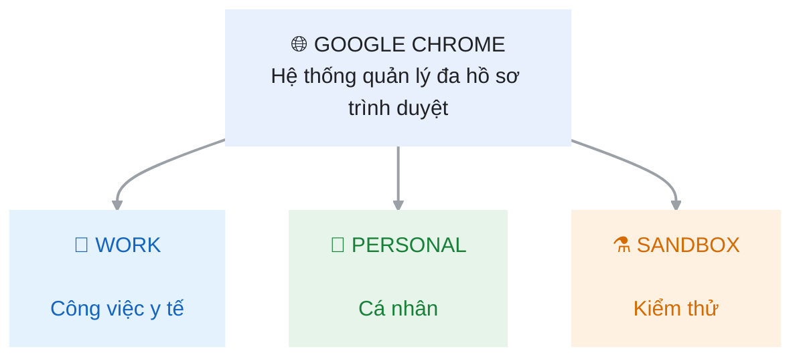

# Bài 9: Thiết Kế Không Gian Đa Profile Và Kiến Trúc Bookmark Cho Trạm Khám Bệnh
## Phần 1: Báo cáo phân tích kiến trúc đa Profile
### 1.	Phân tích nguyên nhân xảy ra Session Conflict
### a.	Khái niệm
-	Cookies: Là các dữ liệu nhỏ được website lưu trên trình duyệt nhằm ghi nhớ thông tin phiên đăng nhập, tùy chọn và trạng thái người dùng.
-	User Data Directory: Là thư mục lưu trữ dữ liệu của một Chrome Profile, bao gồm Cookies, History, Bookmarks, Extensions và các thiết lập cá nhân.
-	Session Conflict: Là hiện tượng xung đột phiên đăng nhập khi nhiều người sử dụng chung môi trường trình duyệt hoặc cùng một tài khoản, dẫn đến tình trạng phiên làm việc bị thay thế hoặc đăng xuất ngoài ý muốn.
### b.	Nguyên nhân sâu xa

Khi nhiều nhân viên sử dụng chung một Chrome Profile, các tab thuộc cùng website có thể sử dụng chung hệ thống Cookies của Profile đó.

**Ví dụ:** Bác sĩ trực đăng nhập CarePulse bằng tài khoản A. Sau đó, người khác đăng nhập tài khoản B trên cùng hệ thống CarePulse. Nếu hệ thống chỉ cho phép một phiên đăng nhập hoặc cập nhật Cookie xác thực dùng chung, phiên của bác sĩ có thể bị thay thế.

**Điều này gây ra các hậu quả**
-	Bác sĩ bị đăng xuất giữa quá trình kê đơn.
-	Gián đoạn công việc khám chữa bệnh.
-	Có nguy cơ thao tác nhầm tài khoản.
-	Ảnh hưởng đến tính bảo mật và tính liên tục của dữ liệu bệnh nhân.
### c.	Giải pháp
Sử dụng nhiều Chrome Profile độc lập. Mỗi Profile có User Data Directory riêng, giúp phân tách Cookies, lịch sử, Bookmark và các thiết lập trình duyệt.

Đề xuất triển khai mô hình gồm Work – Personal – Sandbox.
## CARE PULSE – BROWSER ARCHITECTURE

