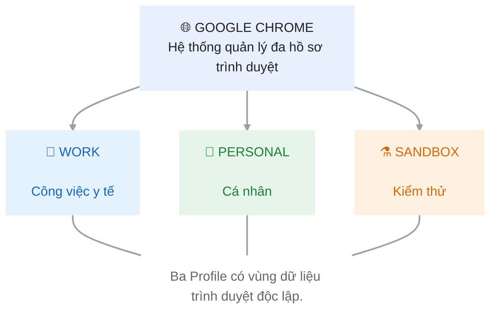

# Bài 9: Thiết Kế Không Gian Đa Profile Và Kiến Trúc Bookmark Cho Trạm Khám Bệnh
## Phần 1: Báo cáo phân tích kiến trúc đa Profile
### 1.	Phân tích nguyên nhân xảy ra Session Conflict
### a.	Khái niệm
-	Cookies: Là các dữ liệu nhỏ được website lưu trên trình duyệt nhằm ghi nhớ thông tin phiên đăng nhập, tùy chọn và trạng thái người dùng.
-	User Data Directory: Là thư mục lưu trữ dữ liệu của một Chrome Profile, bao gồm Cookies, History, Bookmarks, Extensions và các thiết lập cá nhân.
-	Session Conflict: Là hiện tượng xung đột phiên đăng nhập khi nhiều người sử dụng chung môi trường trình duyệt hoặc cùng một tài khoản, dẫn đến tình trạng phiên làm việc bị thay thế hoặc đăng xuất ngoài ý muốn.
### b.	Nguyên nhân sâu xa

Khi nhiều nhân viên sử dụng chung một Chrome Profile, các tab thuộc cùng website có thể sử dụng chung hệ thống Cookies của Profile đó.

**Ví dụ:** Bác sĩ trực đăng nhập CarePulse bằng tài khoản A. Sau đó, người khác đăng nhập tài khoản B trên cùng hệ thống CarePulse. Nếu hệ thống chỉ cho phép một phiên đăng nhập hoặc cập nhật Cookie xác thực dùng chung, phiên của bác sĩ có thể bị thay thế.

**Điều này gây ra các hậu quả**
-	Bác sĩ bị đăng xuất giữa quá trình kê đơn.
-	Gián đoạn công việc khám chữa bệnh.
-	Có nguy cơ thao tác nhầm tài khoản.
-	Ảnh hưởng đến tính bảo mật và tính liên tục của dữ liệu bệnh nhân.
### c.	Giải pháp
Sử dụng nhiều Chrome Profile độc lập. Mỗi Profile có User Data Directory riêng, giúp phân tách Cookies, lịch sử, Bookmark và các thiết lập trình duyệt.

Đề xuất triển khai mô hình gồm Work – Personal – Sandbox.
## CARE PULSE – BROWSER ARCHITECTURE

**Bảng phân tích chi tiết**
|Tiêu chí |	Work |	Personal |	Sandbox|
|---|---|---|---|
|Mục đích	| Khám chữa bệnh |	Nhu cầu cá nhân |	Kiểm thử ứng dụng|
|Cookies	| Tài khoản công việc |	Tài khoản cá nhân	| Tài khoản thử nghiệm|
|History	| Lịch sử công việc| 	Lịch sử cá nhân	| Lịch sử kiểm thử|
|Bookmarks |	CarePulse, BHYT, Dược thư |	Website cá nhân	| Website thử nghiệm|
|Extensions	| Công cụ được phê duyệt	| Tiện ích cá nhân |	Tiện ích phục vụ test|
## Phần 2: Thiết kế hệ thống Bookmark & Quy trình an toàn
### 1.	Xây dựng cây thư mục Bookmark chuẩn
Sử dụng tổ hợp phím Ctrl + Shift + O để mở Trình quản lý dấu trang

**Thiết kế cây thư mục gồm 3 thư mục chính:**
```text
BOOKMARK
    │
    ├── 📁 01_CarePulse_Clinic
    │   ├── CarePulse – Đăng nhập
    │   ├── Tiếp đón và hàng chờ
    │   ├── Hồ sơ bệnh án
    │   ├── Kê đơn điện tử
    |   ├── Chỉ định CLS và kết quả xét nghiệm
    |   ├── Lịch hẹn và tái khám
    |   ├── Viện phí và thanh toán
    |   ├── Báo cáo ca trực
    |   ├── Hỗ trợ IT, báo lỗi
    |   ├── Cổng giám định BHYT
    │   └── Cổng BHXH Việt Nam
    │
    ├── 📁 02_Pharma_Portal
    |   ├── Dược thư Quốc gia Việt Nam
    |   ├── Cục Quản lý Dược
    |   ├── Dịch vụ công – tra cứu số đăng ký thuốc
    |   ├── Cảnh giác Dược (DI và ADR)
    |   ├── Cổng thông tin Bộ Y tế – văn bản dược
    │   ├── Drugs.com – kiểm tra tương tác thuốc
    │   ├── Medscape – Drug Reference
    │   ├── DrugBank
    │   ├── WHO – Essential Medicines
    │   └── Kho thuốc nội bộ (CarePulse Pharmacy)
    │
    └── 📁 03_Medical_Tools
        ├── Google Dịch
        ├── PubMed
        ├── MDCalc – công cụ tính điểm lâm sàng
        ├── WHO ICD-10 / ICD-11
        ├── Cục Quản lý Khám, chữa bệnh
        ├── UpToDate (nếu đơn vị có bản quyền)
        ├── Cochrane Library
        ├── CDC – lịch tiêm chủng
        ├── Phòng họp hội chẩn (Google Meet)
        └── Hướng dẫn chẩn đoán và điều trị
```
### 2.	Áp dụng kỹ thuật Favicon-Only
**Khái niệm:** Favicon-Only là cách hiển thị Bookmark chỉ bằng biểu tượng website (Favicon), loại bỏ phần tên chữ để tiết kiệm diện tích thanh dấu trang.
**Hướng dẫn thực hiện:**
1.	Mở Google Chrome.
2.	Truy cập website CarePulse.
3.	Nhấn Ctrl + D để thêm website vào Bookmark.
4.	Chọn lưu vào Bookmark Bar.
5.	Nhấp chuột phải vào Bookmark vừa tạo.
6.	Chọn Edit.
7.	Xóa toàn bộ nội dung trong ô Name.
8.	Giữ nguyên URL và nhấn Save.
9.	Lặp lại với 3 website còn lại.

**Kết quả:** Thanh Bookmark hiển thị 4 biểu tượng thay vì 4 dòng tên website dài, giúp tiết kiệm không gian và truy cập nhanh hơn.
### 3.	Xử lý tình huống an ninh: Khách mượn máy tính trong 30 phút
Lựa chọn phù hợp nhất là: Guest Profile
### a.	Vì sao chọn Guest Profile thay vì Incognito?
|Tiêu chí |	Guest Profile |	Incognito|
|---|---|---|
|Mục đích |	Cho người khác sử dụng máy tạm thời	| Duyệt web riêng tư trong Profile hiện tại|
|Dữ liệu cá nhân |	Không sử dụng dữ liệu Profile chủ |	Vẫn chạy trong Profile hiện tại|
|Cookies |	Phiên khách tách biệt |	Tách khỏi phiên thông thường nhưng dùng môi trường Profile hiện tại|
|Sau khi đóng	| Dữ liệu phiên khách bị xóa |	Dữ liệu phiên ẩn danh bị xóa|
|Phù hợp máy dùng chung |	Rất phù hợp |	Chỉ phù hợp khi người dùng tự kiểm soát phiên|
### b.	Quy trình thực hiện
1.	Bác sĩ lưu và hoàn tất công việc trên CarePulse.
2.	Đóng các hồ sơ bệnh nhân và đăng xuất khỏi hệ thống theo quy trình của phòng khám.
3.	Nhấn biểu tượng Profile ở góc trên bên phải Chrome.
4.	Chọn Guest (Khách).
5.	Bàn giao máy tính cho khách hoặc đoàn thanh tra.
6.	Sau 30 phút, khách đóng toàn bộ cửa sổ Guest.
7.	Nhân viên kiểm tra lại Profile Work và đăng nhập lại theo quy định.
### c.	Cảnh báo nguy cơ Cloud Sync
Không nên bật Cloud Sync bằng tài khoản Google cá nhân trên máy tính dùng chung của trạm y tế vì:
-	Có nguy cơ đồng bộ Bookmark và lịch sử duyệt web cá nhân lên máy tính công cộng.
-	Có thể lưu mật khẩu cá nhân trên thiết bị dùng chung.
-	Người sử dụng sau có thể tiếp cận thông tin cá nhân nếu không đăng xuất và bảo vệ tài khoản đúng cách.
-	Dữ liệu đồng bộ có thể bị truy cập nếu tài khoản Google bị chiếm quyền.

**Giải pháp đề xuất:**
-	Không đồng bộ dữ liệu cá nhân trên máy trạm y tế.
-	Chỉ sử dụng tài khoản công việc được đơn vị quản lý và phê duyệt.
-	Bật xác thực hai yếu tố (2FA).
-	Khóa màn hình khi rời khỏi máy tính.
-	Không lưu mật khẩu bệnh nhân hoặc thông tin xác thực trên trình duyệt dùng chung.
